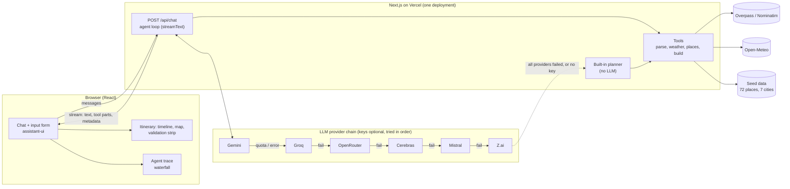
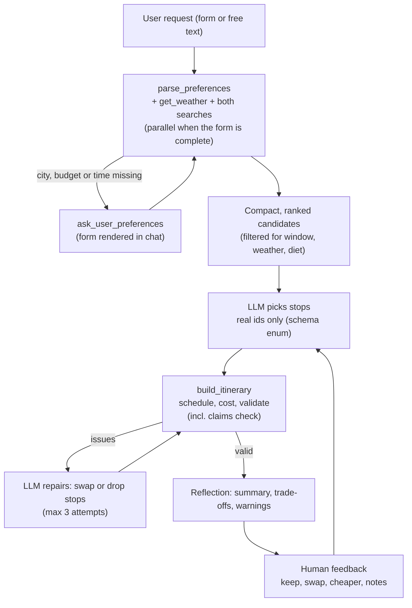

<p align="center"></p>

# WhereTo

**Your perfect Saturday, planned around your mood, budget and time.**

An AI agent that turns "tired but wants to do something fun, ₹2000, 4 hours, vegetarian, no crowds" into a schedule you can actually follow: real places, real travel times, a cost breakdown, a map, and a plan that has been checked before you see it. Every step the agent took is inspectable.

- Live demo: [whereto-planner.vercel.app](https://whereto-planner.vercel.app/)
- Stack: Next.js 16 (App Router), Vercel AI SDK 7, Gemini with Groq, OpenRouter, Cerebras, Mistral and Z.ai failover, assistant-ui, Leaflet, Tailwind 4
- No separate backend, no database: one Next.js deployment

## The idea

A single big prompt produces plausible but unreliable plans: invented places, closed venues, blown budgets. WhereTo splits the job:

| Principle | How |
|---|---|
| **Agent** | The LLM reads intent and decides which tools to call and which places to choose. |
| **Real places** | Candidates come from OpenStreetMap and live weather, backed by seed data. The LLM may only pick from what tools returned. |
| **Validated plans** | Deterministic code checks every draft (budget, time, hours, diet, crowds, weather). Failures go back to the agent to repair. |
| **Transparent runs** | Every LLM call and tool call is traced with latency, tokens, input and output. |

## Architecture



The server is one route handler. It streams AI SDK UI messages: text, tool calls with results, and message metadata (model, per-step tokens). The client derives everything else (itinerary, live steps, trace) from that stream, so there is no server-side session state.

### Model providers and failover

`lib/agent/llm.ts` builds the chain from whichever API keys are set: Gemini, Groq, OpenRouter, Cerebras, Mistral, Z.ai (override with `LLM_PROVIDERS`). A request starts on the first provider. On a quota, auth, billing or overload error it moves to the next, and the failed provider is skipped for a cooldown (30 min quota, 60 min bad key or billing, 60 s transient; per server instance). The failover **resumes**: the steps a provider completed (tool calls and results) are handed to the next one, so it carries on from that point instead of repeating them; if the next provider rejects that history it is retried once from a clean start. The chat shows one small notice per switch ("Gemini hit its quota. Continuing with Groq, picking up from the steps already done."), and the trace shows the provider on every model step. The built-in planner runs only when none succeed. Keys and model overrides are in [Run locally](#run-locally).

Notes: Gemini, Groq and Z.ai have been exercised against their live APIs; the others are wired the same way but untested here (Mistral and Cerebras require a payment method or subscription). Open models follow the tool flow less reliably than Gemini, so the validator and the failover are what keep a bad run from reaching the user. Thinking output is stripped from requests to providers that reject it, and Z.ai runs with thinking off to save the output cap.

### Agent loop



### Tools

| Tool | Purpose | Data source |
|---|---|---|
| `parse_preferences` | Normalise intent into structured preferences; detect missing fields | none (pure) |
| `ask_user_preferences` | Human-in-the-loop: renders an input form in the chat, the submission is the tool result | none (client UI) |
| `get_weather` | Geocode the city, forecast for the coming Saturday | Open-Meteo |
| `get_activity_options` | Candidate places filtered by interests, crowds, weather | Overpass, Nominatim, seed data |
| `get_food_options` | Restaurants and cafes filtered by diet, per-person budget, crowds | Overpass, Nominatim, seed data |
| `build_itinerary` | Schedule stops, compute travel legs and cost, validate (sub-steps `geocode_start_location`, `schedule_stops`, `estimate_cost`, `validate_plan`) | Nominatim (start point), pure logic |

## Guardrails

- **Grounding, two layers.** `build_itinerary` accepts only place ids returned by the search tools. The registry is rebuilt from chat history on every request, so follow-up swaps stay grounded. Layer one: once the searches have run, the schema the model sees lists the real ids as an `enum`, so it cannot even write another. Layer two: the tool still rejects unknown ids as a validation failure.
- **The user's numbers are authoritative.** Budget, time, people, start and diet come from the form, not from what the model re-types. The model may make a plan cheaper or shorter, never larger, and cannot switch off a stated constraint. The one way a number goes up is the user saying it: a budget or time is accepted only if that number appears in their latest chat message ("make it 500"). When the in-chat form reopens, the server pre-fills it from what it already knows, whatever the model passed. Typing in the chat instead of using the form is fine; the form is then shown as skipped, not confirmed. A raised budget stays raised on later turns, drafts are capped at 5 per turn, and the last allowed model step is forced to be a written answer, so a run never ends silently on a tool call.
- **Claims are checked.** The model's "why" and "trade-off" text is scanned: "quiet" on a crowded place, "free entry" on a paid one, "vegetarian" on a non-veg place, and rupee amounts that match nothing in the plan are validation failures. Totals are always computed by code, never by the model.
- **Deterministic validation, not LLM judgement.** Hard failures: budget exceeded, plan longer than the time window, visit outside opening hours, too many stops for the window, fewer than 2 stops, non-vegetarian place for a vegetarian, crowded place when avoiding crowds, outdoor stop with rain probability of 55% or more.
- **Warnings** (surfaced to the user, do not block): unconfirmed vegetarian menu, no meal in a 3h+ plan, travel over 30% of the plan, legs over 35 minutes, peak heat outdoors, outdoor after 7pm, groups of 6+ (reserve tables).
- **Honesty about data.** Places show their source (`OpenStreetMap` or `curated`). Costs and durations are labelled estimates, and plans outside India carry a warning that prices are rough rupee-based defaults. Unknown diet data is flagged, not assumed.
- **City understanding.** A geocoder hit is never trusted blindly (a bare "abc" resolves to Albacete, Spain, because ABC is that airport's code). How far a hit is trusted depends on how well it matches what was typed:

  | Typed | Match | Behaviour |
  |---|---|---|
  | "Bengaluru", "Bombay", "Delhi, India" | exact (seeded city, alias, or the place's own name) | plan; seeded aliases report the right city and country (Bombay is Mumbai, India, not a village abroad) |
  | "Bangalor", "Hyderbad" (typo of a seeded city) | close, corrected offline against the seed list | plan, and the plan header says what was understood |
  | "Mysore", "NYC", "Peking" (the geocoder has junk or a namesake) | OpenStreetMap independently names a settlement | plan for that settlement, with the same note |
  | "Goa" (a small place abroad shares the name) | second opinion from OpenStreetMap; an Indian settlement wins, and if OpenStreetMap cannot be asked the user is asked | |
  | "abc", "BLR" (an airport code or abbreviation) | the hit does not resemble the input | no plan: "Did you mean Albacete, Spain?" with a one-tap button and the form reopened |
  | "Zzzxqwland" | nothing matches | no plan: ask for the city again |

  Only populated places and administrative areas count as cities (airports, islands and toll gates are ignored). The plan header always shows the resolved place and country, and plans outside India carry a warning that prices are rough rupee-based defaults.
- **Zero model tokens for a bad city.** A form submission carries the city as structured data, so the server checks it before any model call. An unknown or doubtful city never reaches the model; the trace shows an "input check (no AI call)" run. Free-text requests cannot be checked up front, so there the `get_weather` tool performs the same check and returns an instruction to ask the user.
- **Input hygiene.** Non-positive budgets or durations are treated as missing (the user is asked), absurd values are capped (16 hours, 50 people), visit lengths are clamped, duplicate stops are rejected. Malformed requests get a 400, oversized conversations a 413.
- **A run that ends with nothing is a failure.** If a model stops without text or a tool call (a reasoning model spending its whole output cap thinking, finish reason `length`), the attempt is treated like any provider error: the next provider tries, then the built-in planner. Reasoning models are asked to think briefly, and models that send `null`, or numbers and lists written as strings ("2000", "[\"food\"]", "None"), are repaired instead of failing the step.
- **Hard caps per run.** 8 model steps, 1,500 output tokens, no retries on a failing provider (the next one takes over; the last gets 1 retry), 60s function limit, 12 requests per minute per IP. The models get 40 seconds from the start of the request; after that the built-in planner answers, so a slow model can never leave an empty run.
- **Graceful failure.** Unknown city, no matching places, source outage, model outage: each has a defined user-facing outcome (see Built-in planner and Data sources).

## Feedback loops

1. **Validation loop (self-repair).** A failed `build_itinerary` returns `VALIDATION FAILED` with the exact issues. The agent revises and calls it again, up to 3 times. If it still cannot fit (for example a ₹300 budget), it builds the best cheaper plan and says what was cut.
2. **Reflection.** After a valid plan the model writes a short explanation: why it fits, honest trade-offs, and any validation warnings. The UI separately shows the checks that ran, with pass / warn / fail state.
3. **Human feedback.**
   - Missing, vague or doubtful input (including an unclear city): the agent asks through an in-chat form instead of guessing. The run resumes automatically only after that form is answered; the rule (`lib/hitl.ts`) is deliberately narrow, because the AI SDK's stock helper would re-send forever after any finished run whose tools executed on the server.
   - Per stop: **Keep** and **Swap it**.
   - Plan level: "Cheaper", "Less walking", "More food", "Shorter day".
   - These are sent as structured `[feedback]` messages; the agent re-plans from already-fetched options and keeps liked stops. Feedback events appear in the trace.
   - Notes per stop, included in share links.

## Observability

Every tool call and LLM step is a span: name, start and end, status (`ok`, `fallback`, `error`), input, output, and tokens for LLM steps. Spans nest (for example `build_itinerary` → `schedule_stops`, `estimate_cost`, `validate_plan`; each OSM source attempt is its own span). The Agent trace tab shows:

- run summary: latency, LLM calls, tool calls, input and output tokens, fallback count
- a waterfall on a shared time axis, with expandable input and output side by side
- fallbacks in amber hatching, human input in teal, errors in red

Implementation: a `traced()` wrapper records spans per request. Tool results carry compact span data; LLM step timing and token usage travel as message metadata. The client reads both, so tracing needs no storage.

## Built-in planner (no LLM)

When the model is unavailable (quota, outage, missing key) the same response stream switches to a deterministic planner and tells the user why, in a warning callout. It calls the same tools and the same validation, so the itinerary, map and trace look identical.

- Selection: scores places by interest match, crowd, cost and distance; skips places closed for the requested window; limits stop count to the window; diversifies categories.
- Ordering: opens with a place that is already open at the start time; meals placed sensibly for morning or evening starts.
- Repair: shorten visits first, then replace or drop offending stops. Handles Keep, Swap and Cheaper feedback.
- Quality: simpler than the agent (templated explanations), but valid on first attempt in all tested cases (7 cities, evening start, group of 4, custom start point).

## Data sources

| Service | Used for | If it fails |
|---|---|---|
| Open-Meteo (geocoding + forecast) | City coordinates (several candidates, settlements only), Saturday weather | Forecast: assume fair weather, say so, keep planning. Geocoding: seeded cities use their stored centre; other cities fall through to Nominatim |
| Overpass API (OpenStreetMap) | Primary live place search | Skipped for 5 minutes after a failure; falls through to Nominatim |
| Nominatim (OpenStreetMap) | Second live place source; second city geocoder and independent second opinion on doubtful city matches (settlement-level, English names); geocoding the start point | Places: fall back to seed data. Start point: treated as not found, with a warning. City: reported unknown only if every source misses it |
| Wikipedia search API | Place photos, fetched in the browser | Emoji tile |
| OpenStreetMap tiles + Leaflet | Map | Map degrades, plan unaffected |
| Google Maps URLs | Directions deep links only (no API) | n/a |

All are keyless public services. Requests contain only city names, the optional start-point text and coordinates; no accounts or personal data.

**Seed data.** 72 hand-written places across 7 cities (Bangalore 15, Delhi 14, Mumbai 10, Pune 9, Hyderabad 8, Chennai 8, Kolkata 8) in `lib/data/`. They guarantee a working demo when live sources are slow or blocked, and give richer attributes (diet, crowd, hours) than OSM provides. Coordinates, prices and crowd levels are approximate and marked `curated` in the UI. OSM-sourced places use category-based defaults for cost, duration and crowd.

## Cost and token efficiency

Before the token work, a typical run was 5 LLM calls and about 22k input tokens (measured on a live run). Now:

- The model reads a compact table of each tool result (`toModelOutput`); the UI, trace and saved chat keep the full data.
- Candidates are ranked and filtered for the time window, weather and diet before the model sees them (10 activities, 8 food places).
- Tool schemas are slim (about 850 tokens for all five) and the system prompt is shorter.
- The first step runs parse, weather and both searches in parallel, so a run is 3 model calls instead of 4 to 5.

On a scripted model through the real SDK loop the input drops from 36.5k to 20.4k characters (about 44%), asserted in `tests/token-budget.test.ts`. My estimate for a live run is about 7k input tokens; I have not re-measured that live, so treat it as an estimate. Other controls: low thinking level, step and output caps, and the zero-LLM fallback. Weather, geocoding and place data cost nothing.

A free-tier Gemini key allows only a few runs per day, so a second provider key makes the demo much sturdier. For a public deployment use a billed key with a quota and budget alert. Provider failover is described under [Architecture](#model-providers-and-failover).

## Run locally

Node 20+.

```bash
npm install
cp .env.example .env.local     # add at least one provider key
npm run dev                    # http://localhost:3000
```

| Variable | Default | Purpose |
|---|---|---|
| `GOOGLE_GENERATIVE_AI_API_KEY` (or `GEMINI_API_KEY`) | none | Gemini key |
| `GROQ_API_KEY`, `OPENROUTER_API_KEY`, `CEREBRAS_API_KEY`, `MISTRAL_API_KEY`, `ZAI_API_KEY` | none | Fallback providers. With no key at all the app runs on the built-in planner only |
| `LLM_PROVIDERS` | `google,groq,openrouter,cerebras,mistral,zai` | Priority order; providers without a key are skipped |
| `GROQ_MODEL`, `OPENROUTER_MODEL`, `CEREBRAS_MODEL`, `MISTRAL_MODEL`, `ZAI_MODEL` | `openai/gpt-oss-120b`, `openrouter/free`, `gpt-oss-120b`, `mistral-small-latest`, `glm-4.5-flash` | Model ids |
| `GEMINI_MODEL` | `gemini-3.5-flash` | Gemini model id |
| `GEMINI_THINKING` | `low` | Gemini thinking level |
| `NEXT_PUBLIC_SITE_URL` | Vercel's production URL | Absolute base URL for link-preview images. Only needed for a custom domain |

Deploy: import the repo in Vercel, set the same variables, deploy. No other configuration.

## Testing

```bash
npm test          # 432 tests, about 2 seconds, no network or API key needed
npm run typecheck
```

All network providers and the LLM are mocked, so runs are deterministic. Coverage:

| Suite | What it pins down |
|---|---|
| `plan.test.ts` | `validatePlan`, scheduling and costing: every hard rule and warning, boundaries (exactly on budget, 54% vs 55% rain, tolerance windows), groups, midnight closings, clamped durations, duplicates, hallucinated ids |
| `prefs.test.ts` | Input normalisation: missing, negative or absurd values; "non-vegetarian" is not vegetarian; crowd negations; time parsing |
| `tools.test.ts` | The contract the LLM agent runs against: city not found, source outages and fallbacks, empty results without inventing places, diet, crowd and weather filters, the human-in-the-loop tool, scripted repair loops (fail, fix, pass), history grounding |
| `fallback.test.ts` | The built-in planner: valid first-attempt plans in all seeded cities, evening and group plans, unknown city, missing details, unmeetable budget or time (honest best effort), live-source and weather outages, Keep, Swap, Cheaper and Shorter feedback |
| `city.test.ts`, `geocode*.test.ts`, `nominatim-city.test.ts`, `city-flow.test.ts` | City understanding: name matching and typo rules, the exact / close / suggest / unknown tiers, candidate selection (settlements first), seeded aliases and typo correction, geocoder and Nominatim fallbacks, how the tools and the built-in planner react to each outcome |
| `city-route.test.ts` | The pre-check: a bad city never reaches the model, the reopened form, no spurious AI-unavailable notice, later turns are not re-checked |
| `hitl.test.ts` | When the client resumes after the in-chat form, verified on real streamed output, including that a finished plan can never trigger a re-send |
| `route.test.ts` | LLM mode and the switch to the built-in planner (model error before or after tool calls, no key), stream well-formedness, tool set and cost caps, request guards, rate limiting |
| `llm.test.ts`, `route-failover.test.ts`, `route-resume.test.ts` | Provider order and keys, error classification, cooldowns, failover mid-stream, resuming from completed steps through the real SDK loop, reasoning stripped from requests, the user's values staying authoritative |
| `deadline.test.ts` | A model that never answers is cut off and the built-in planner still delivers a validated plan (but if a validated plan already exists when the deadline hits, that plan is kept with a short note instead); OSM restaurants whose name or cuisine is plainly meat are not offered to vegetarians |
| `amend.test.ts` | A budget raised in chat stays in force, the draft cap, and the forced written answer on the last step |
| `ask-form.test.ts` | Form pre-fill from server knowledge, a number counted as the user's only if they wrote it, the per-meal floor and the cheapest-over-budget fallback |
| `agent-quality.test.ts` | Ranking, claims checker, compact model views, id enum, a scripted model through the real agent loop |
| `token-budget.test.ts`, `parallel-step.test.ts` | Token regression guard (at least 40% less input), parallel first step, one forecast and one city lookup per run |

I also ran mutation checks: deliberately broken behaviours (budget rule removed, hallucinated ids accepted, fallback switch disabled, bad cities reaching the model, doubtful matches accepted, resume-after-any-tool loop hazard, and more) and confirmed each one makes the suite fail.

Mocked tests alone are not enough for the city logic: the real Open-Meteo and Nominatim responses behave differently from what I first assumed (Nominatim's `jsonv2` calls a field `category`, Open-Meteo matches by prefix and returns airports), so the resolver was also verified against the live services.

## Project layout

```
app/api/chat/route.ts      agent loop, streaming, LLM-to-fallback switch, rate limit
app/s/page.tsx             read-only shared itinerary
lib/agent/tools.ts         the tools (thin traced wrappers), history-seeded place registry
lib/agent/plan.ts          pure scheduling, costing and validatePlan
lib/agent/claims.ts        checks the model's why / trade-off text against the data
lib/agent/rank.ts          ranks and filters candidates before the model sees them
lib/agent/schema.ts        live id enum for build_itinerary
lib/agent/model-view.ts    compact tool results for the model
lib/agent/llm.ts           provider chain, error classification, cooldowns
lib/agent/prefs.ts         pure input normalisation and constraint detection
lib/agent/city.ts          city understanding: exact / close / suggest / unknown
lib/agent/text.ts          pure name-matching helpers
lib/hitl.ts                when the client resumes after the in-chat form
lib/agent/fallback.ts      built-in planner
lib/agent/providers.ts     Open-Meteo, Overpass, Nominatim clients
lib/agent/trace.ts         span recording
lib/data/                  seed places
components/planner/        chat, form, itinerary, map, trace, theme
tests/                     vitest suites (see Testing)
```

## Design decisions

- **Stateless.** The plan is encoded in the share link's URL fragment, so sharing needs no database and no server stores user plans. Trade-offs: links are snapshots and fairly long, and because the fragment never reaches a server, a shared link previews as a generic branded WhereTo card (the home page and share links both ship a 1200x630 Open Graph image).
- **Validation in code.** Constraints that must hold (budget, hours, diet) are checked by deterministic functions the model cannot talk its way around.
- **Tool results as the UI's data source.** The itinerary and trace are derived from the streamed tool results, so what you see is exactly what the agent did.
- **assistant-ui primitives** for the chat runtime and tool UIs (including the human-in-the-loop form); everything visual on top is custom.

## Known limits and roadmap

- Public OSM endpoints are rate-limited and occasionally down (Overpass often). Fallbacks cover it; a short-lived cache per city and category would reduce load and latency.
- Rate limiting is in-memory per server instance: a speed bump, not a guarantee. Next: Upstash for exact limits, plus a daily LLM budget that routes to the built-in planner when exceeded.
- Ambiguous city names resolve to the most populous exact match (for example "Springfield"), with an Indian place preferred when the geocoder's hit is a small place abroad (the product's home market). The plan header always shows the country. Typos of cities outside the seed list are not corrected, because neither geocoder fuzzy-matches; the user is simply asked again.
- Nominatim's public service is limited to about one request per second, so the second-opinion lookups are only made for doubtful matches.
- Travel times are estimated from distance, not routed. Next: a routing API.
- Share links are long and previews are generic. Next: compression, a versioned format, and optional short links backed by storage, which would also allow plan-specific previews (title, stops, cost).
- Chat history is lost on refresh. Next: persist the current session in `localStorage`.
- Richer place data (ratings, price level, photos) via a paid places API.

## How AI tools were used

Built with Claude Code as a pair programmer for scaffolding, the agent and tool design, the validator and fallback planner, and UI iteration, with all behaviour verified by running it (tool-level tests, scripted API runs across cities, headless browser checks on desktop and mobile). Architecture, guardrail rules and product decisions were set by me and reviewed in the code.
